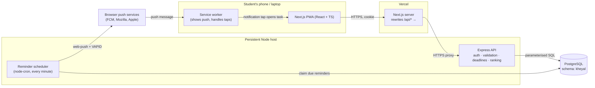
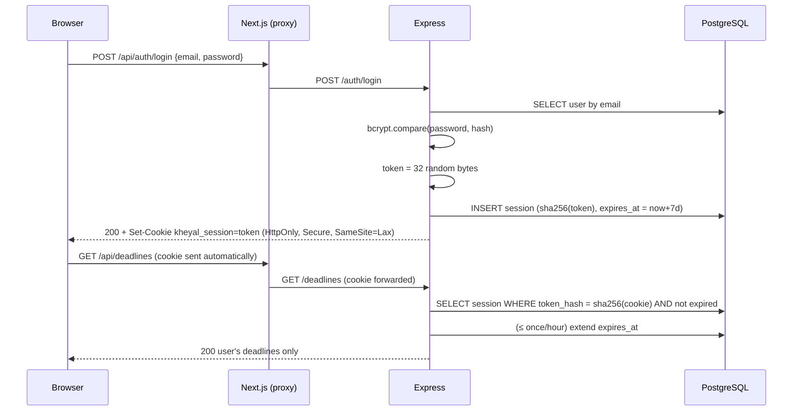
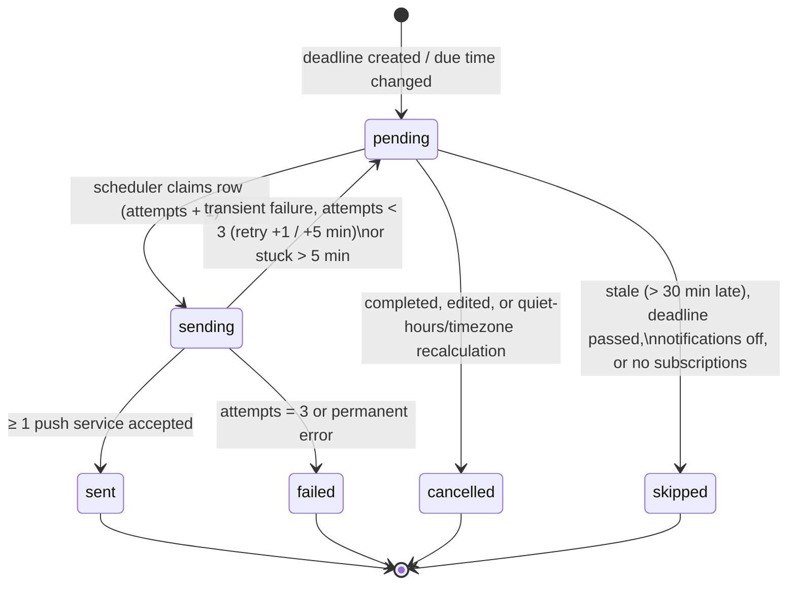

# Kheyal — Architecture

Phase A (deadline MVP). See [decisions.md](decisions.md) for the reasoning behind each choice (IDs like `D-04`).

## 1. System overview



Key rules:

1. The browser **never** talks to PostgreSQL, and never directly to Express in production — only to the Next.js origin (`D-04`).
2. Next.js contains **no business logic**. It renders UI and proxies `/api/*`.
3. All validation, ownership checks, ranking, parsing and reminder logic live in Express.
4. Reminder **timing** is server-side. The service worker is not a clock; it only displays pushes and handles clicks.

## 2. Backend layers

```text
backend/src/
├── server.js          # starts HTTP server + scheduler, graceful shutdown
├── app.js             # builds the Express app (imported by tests without listening)
├── config/            # env parsing (Zod), db pool, constants
├── middleware/        # auth, origin check (CSRF), rate limits, error handler
├── routes/            # URL → controller wiring only
├── controllers/       # thin: read validated input, call service, shape response
├── validators/        # Zod schemas for bodies / params / queries
├── services/          # business logic: auth, deadlines, parsing, ranking, reminders, push
├── repositories/      # the ONLY place SQL lives; always parameterised, always user-scoped
├── jobs/              # reminder scheduler tick
└── utils/             # small pure helpers (time maths, errors)
```

Request lifecycle:

```text
request → helmet (security headers) → JSON body limit → origin check (mutations)
        → rate limit (auth routes) → authenticate (cookie → session → user)
        → Zod validation → controller → service → repository (SQL)
        → JSON envelope response  |  error handler (safe message, no stack/SQL)
```

## 3. Authentication flow (`D-01`…`D-05`)



## 4. Deadline capture flow

```text
"DBMS assignment due 25/10 5pm 6h"
   │  POST /deadlines/parse          (no DB writes)
   ▼
chrono-node en-GB + effort regex + title cleanup
   ▼
Preview: title, due (local + UTC), hasDueTime, effort, warnings[], reminder preview
   │  user reviews / edits / confirms
   ▼
POST /deadlines (validated again by Zod — the client is never trusted)
   ▼
Transaction: INSERT deadline → compute reminder times (offsets, quiet hours, skip past) → INSERT reminders
```

## 5. Reminder lifecycle



Deleting a deadline removes its reminder rows entirely (`ON DELETE CASCADE`, `D-17`).

### Scheduler tick (every minute)

1. **Recover** rows stuck in `sending` > 5 min → `pending`.
2. **Expire** pending rows past the grace window or past their deadline → `skipped`.
3. **Claim** up to N due rows atomically (`FOR UPDATE SKIP LOCKED` → `sending`).
4. For each claimed row: load the user's preferences and subscriptions, send via `web-push`, record outcome (`sent` / retry / `failed`), delete subscriptions that return 404/410.

Atomic claiming is what prevents duplicate notifications — two ticks (or two servers) can never claim the same row.

## 6. Time handling

- Stored: `TIMESTAMPTZ` (UTC). Pool sets `TimeZone=UTC` per connection.
- API: ISO-8601 strings with `Z`. Date-only input uses `YYYY-MM-DD`.
- Local maths (23:59, 22:30, 07:00, quiet hours, display) uses the user's IANA timezone via Luxon.

## 7. Deployment topology (decided in Milestone 9)

| Part | Host | Notes |
|---|---|---|
| Next.js frontend + proxy | Vercel | `BACKEND_URL` env var for rewrites |
| Express API + scheduler | Persistent Node host (TBD) | Must not sleep, or reminders stop |
| PostgreSQL | Managed (e.g. Neon / Supabase, TBD) | Separate least-privilege app role |

## 8. Planned dependencies (installed only in the milestone that needs them)

| Package | Milestone | Why |
|---|---|---|
| `helmet` | 3 | Sensible security headers, removes `X-Powered-By` |
| `bcrypt` | 4 | Password hashing (PRD requirement) |
| `cookie-parser` | 4 | Read the session cookie (Express 5 has no built-in cookie parsing) |
| `express-rate-limit` | 4 | Login/signup brute-force protection |
| `chrono-node` | 6 | Natural-language date parsing (PRD) |
| `luxon` | 6 | Reliable timezone conversion (local 23:59 → UTC, quiet hours) |
| `web-push` | 8 | VAPID-signed push messages (PRD) |
| `node-cron` | 8 | Minute-level scheduler (PRD) |
| `jest`, `supertest` (dev) | 3 | Unit + HTTP integration tests |
| `next`, `react`, `typescript` | 7 | Frontend (PRD) |
