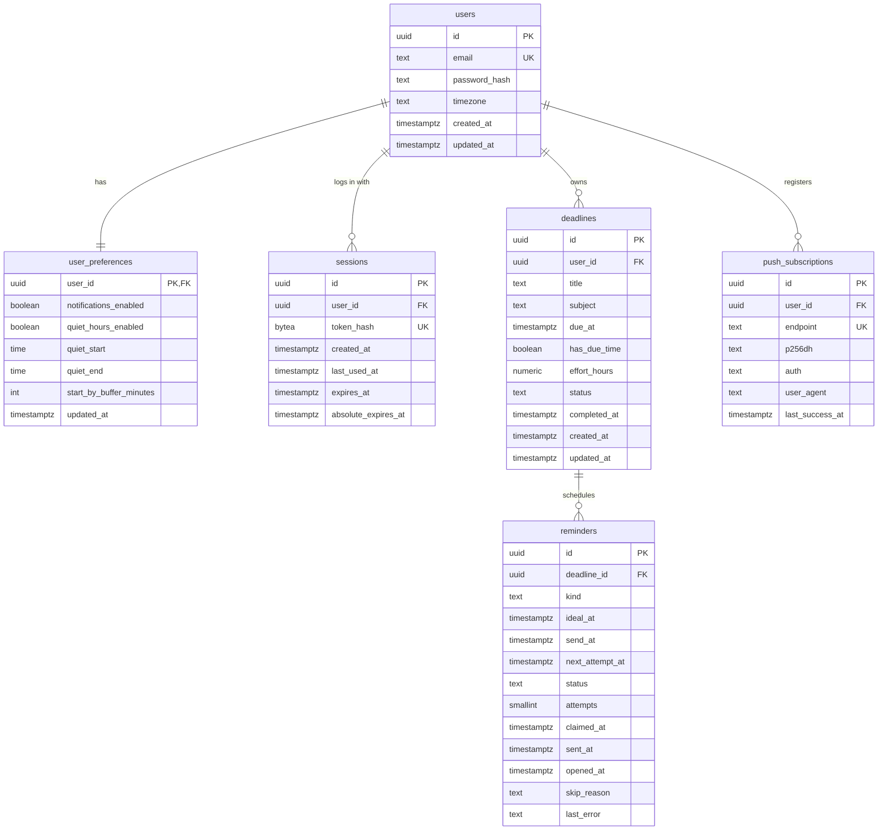

# Kheyal — Database Design

PostgreSQL 18 (local) · schema `kheyal` · app role `kheyal_app` (non-superuser).
This is the **design**; the executable version will be `backend/migrations/0001_initial_schema.sql` in Milestone 3.

## 1. Entity-relationship diagram



Differences from the PRD's initial model (all additive):

| Addition | Why |
|---|---|
| `user_preferences` table | PRD has `/me/preferences` and FR-15 but no storage for them |
| `sessions` table | Session-token auth (`D-01`) |
| `deadlines.has_due_time` | Date-only deadlines (`D-12`) |
| `reminders.ideal_at` vs `send_at` | Keep the pre-quiet-hours time for explainability ("moved earlier from 03:00") |
| `reminders.next_attempt_at`, `claimed_at`, `skip_reason` | Retries, stuck-row recovery, honest skip reporting |
| `kind` values `night_before`, `morning_of` | Date-only reminder schedule (`D-24`) |

## 2. Draft DDL

```sql
-- users -----------------------------------------------------------------------
CREATE TABLE users (
  id             uuid        PRIMARY KEY DEFAULT gen_random_uuid(),
  email          text        NOT NULL,
  password_hash  text        NOT NULL,
  timezone       text        NOT NULL DEFAULT 'Asia/Kolkata',
  created_at     timestamptz NOT NULL DEFAULT now(),
  updated_at     timestamptz NOT NULL DEFAULT now(),
  CONSTRAINT users_email_normalised CHECK (email = lower(btrim(email))),
  CONSTRAINT users_email_length     CHECK (char_length(email) BETWEEN 3 AND 254)
);
CREATE UNIQUE INDEX users_email_key ON users (email);

-- user_preferences (1:1 with users) ------------------------------------------
CREATE TABLE user_preferences (
  user_id                  uuid        PRIMARY KEY REFERENCES users(id) ON DELETE CASCADE,
  notifications_enabled    boolean     NOT NULL DEFAULT true,
  quiet_hours_enabled      boolean     NOT NULL DEFAULT true,
  quiet_start              time        NOT NULL DEFAULT '23:00',
  quiet_end                time        NOT NULL DEFAULT '07:00',
  start_by_buffer_minutes  integer     NOT NULL DEFAULT 120,
  updated_at               timestamptz NOT NULL DEFAULT now(),
  CONSTRAINT prefs_quiet_distinct CHECK (quiet_start <> quiet_end),
  CONSTRAINT prefs_buffer_range   CHECK (start_by_buffer_minutes BETWEEN 0 AND 1440)
);
-- The "quiet window ≤ 12 h" rule (D-27) is enforced in the Zod validator,
-- because it needs wrap-around-midnight arithmetic.

-- sessions --------------------------------------------------------------------
CREATE TABLE sessions (
  id                   uuid        PRIMARY KEY DEFAULT gen_random_uuid(),
  user_id              uuid        NOT NULL REFERENCES users(id) ON DELETE CASCADE,
  token_hash           bytea       NOT NULL,          -- SHA-256 of cookie token
  created_at           timestamptz NOT NULL DEFAULT now(),
  last_used_at         timestamptz NOT NULL DEFAULT now(),
  expires_at           timestamptz NOT NULL,          -- sliding (7 days)
  absolute_expires_at  timestamptz NOT NULL,          -- hard cap (60 days)
  CONSTRAINT sessions_token_hash_len CHECK (octet_length(token_hash) = 32)
);
CREATE UNIQUE INDEX sessions_token_hash_key ON sessions (token_hash);
CREATE INDEX sessions_user_id_idx    ON sessions (user_id);
CREATE INDEX sessions_expires_at_idx ON sessions (expires_at);

-- deadlines -------------------------------------------------------------------
CREATE TABLE deadlines (
  id            uuid          PRIMARY KEY DEFAULT gen_random_uuid(),
  user_id       uuid          NOT NULL REFERENCES users(id) ON DELETE CASCADE,
  title         text          NOT NULL,
  subject       text,
  due_at        timestamptz   NOT NULL,
  has_due_time  boolean       NOT NULL DEFAULT true,
  effort_hours  numeric(5,2),                         -- NULL = unknown
  status        text          NOT NULL DEFAULT 'active',
  completed_at  timestamptz,
  created_at    timestamptz   NOT NULL DEFAULT now(),
  updated_at    timestamptz   NOT NULL DEFAULT now(),
  CONSTRAINT deadlines_title_len    CHECK (char_length(btrim(title)) BETWEEN 1 AND 200),
  CONSTRAINT deadlines_subject_len  CHECK (subject IS NULL OR char_length(btrim(subject)) BETWEEN 1 AND 100),
  CONSTRAINT deadlines_effort_range CHECK (effort_hours IS NULL OR (effort_hours > 0 AND effort_hours <= 500)),
  CONSTRAINT deadlines_status_valid CHECK (status IN ('active', 'completed')),
  CONSTRAINT deadlines_completed_consistent
    CHECK ((status = 'completed') = (completed_at IS NOT NULL))
);
CREATE INDEX deadlines_user_status_due_idx ON deadlines (user_id, status, due_at);

-- reminders -------------------------------------------------------------------
CREATE TABLE reminders (
  id               uuid        PRIMARY KEY DEFAULT gen_random_uuid(),
  deadline_id      uuid        NOT NULL REFERENCES deadlines(id) ON DELETE CASCADE,
  kind             text        NOT NULL,
  ideal_at         timestamptz NOT NULL,   -- before quiet-hours adjustment
  send_at          timestamptz NOT NULL,   -- after adjustment
  next_attempt_at  timestamptz NOT NULL,   -- = send_at, pushed back on retry
  status           text        NOT NULL DEFAULT 'pending',
  attempts         smallint    NOT NULL DEFAULT 0,
  claimed_at       timestamptz,
  sent_at          timestamptz,
  opened_at        timestamptz,
  skip_reason      text,
  last_error       text,                   -- short, sanitised; never secrets
  created_at       timestamptz NOT NULL DEFAULT now(),
  updated_at       timestamptz NOT NULL DEFAULT now(),
  CONSTRAINT reminders_kind_valid CHECK (kind IN ('48h', '24h', '6h', 'night_before', 'morning_of')),
  CONSTRAINT reminders_status_valid
    CHECK (status IN ('pending', 'sending', 'sent', 'failed', 'cancelled', 'skipped')),
  CONSTRAINT reminders_attempts_range CHECK (attempts BETWEEN 0 AND 10),
  CONSTRAINT reminders_send_not_after_ideal CHECK (send_at <= ideal_at),
  CONSTRAINT reminders_skip_reason_required
    CHECK ((status = 'skipped') = (skip_reason IS NOT NULL)),
  CONSTRAINT reminders_last_error_len CHECK (last_error IS NULL OR char_length(last_error) <= 500)
);
-- Duplicate prevention: at most ONE live reminder per (deadline, kind).
CREATE UNIQUE INDEX reminders_one_live_per_kind
  ON reminders (deadline_id, kind) WHERE status IN ('pending', 'sending');
-- Fast scheduler lookup.
CREATE INDEX reminders_pending_due_idx
  ON reminders (next_attempt_at) WHERE status = 'pending';
CREATE INDEX reminders_deadline_idx ON reminders (deadline_id);

-- push_subscriptions ----------------------------------------------------------
CREATE TABLE push_subscriptions (
  id               uuid        PRIMARY KEY DEFAULT gen_random_uuid(),
  user_id          uuid        NOT NULL REFERENCES users(id) ON DELETE CASCADE,
  endpoint         text        NOT NULL,
  p256dh           text        NOT NULL,
  auth             text        NOT NULL,
  user_agent       text,
  created_at       timestamptz NOT NULL DEFAULT now(),
  last_success_at  timestamptz,
  CONSTRAINT push_endpoint_https CHECK (endpoint LIKE 'https://%'),
  CONSTRAINT push_endpoint_len   CHECK (char_length(endpoint) <= 2048)
);
CREATE UNIQUE INDEX push_subscriptions_endpoint_key ON push_subscriptions (endpoint);
CREATE INDEX push_subscriptions_user_idx ON push_subscriptions (user_id);
```

`updated_at` is set explicitly by repository `UPDATE` statements (no triggers), keeping behaviour visible in code.

## 3. Ownership enforcement

Every user-facing query includes the authenticated user's id — never just the record id:

```sql
-- ✅ correct: scoped
UPDATE deadlines SET title = $1, updated_at = now()
WHERE id = $2 AND user_id = $3
RETURNING *;

-- ❌ never: unscoped (would let User A edit User B's deadline)
UPDATE deadlines SET title = $1 WHERE id = $2;
```

Zero rows affected → `404` (`D-38`). Reminders are only reached through a deadline the user owns.

## 4. Key scheduler queries (design)

```sql
-- Claim up to $1 due reminders atomically. SKIP LOCKED means a concurrent
-- claimer simply skips rows already being processed — no duplicates.
WITH due AS (
  SELECT id FROM reminders
  WHERE status = 'pending' AND next_attempt_at <= now()
  ORDER BY next_attempt_at
  LIMIT $1
  FOR UPDATE SKIP LOCKED
)
UPDATE reminders r
SET status = 'sending', claimed_at = now(), attempts = r.attempts + 1, updated_at = now()
FROM due
WHERE r.id = due.id
RETURNING r.id, r.deadline_id, r.kind, r.send_at, r.attempts;

-- Expire stale reminders (grace window $1, e.g. '30 minutes').
UPDATE reminders r
SET status = 'skipped', skip_reason = 'stale', updated_at = now()
FROM deadlines d
WHERE r.deadline_id = d.id
  AND r.status = 'pending'
  AND (r.send_at < now() - $1::interval OR d.due_at <= now());
```

## 5. Migrations (`D-35`)

```text
backend/migrations/
├── 0001_initial_schema.sql
├── 0002_....sql
backend/scripts/db/migrate.js   # runner
```

The runner:

1. Creates `schema_migrations (version text PK, checksum text, applied_at timestamptz)` if missing.
2. Reads files in numeric order; skips versions already applied.
3. Refuses to run if an applied file's checksum changed (migrations are append-only).
4. Runs each new file inside `BEGIN … COMMIT`; any error rolls back that file and stops.

Command (planned): `npm run db:migrate` from `backend/`.

## 6. Data retention (MVP)

| Data | Retention |
|---|---|
| Expired sessions | Deleted by a daily cleanup in the scheduler |
| Reminders of existing deadlines | Kept (metrics: delivery rate, taps) |
| Deleted deadlines | Gone immediately with their reminders |
| Account deletion | Cascades to everything (endpoint planned before public launch) |
